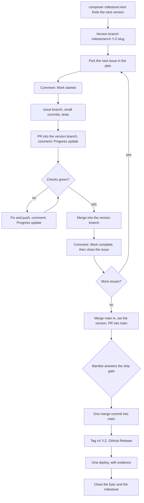

# Contributing to EASM

Thank you for helping. Please write in UK English. Set up Laravel Herd first ([Start here in AGENTS.md](AGENTS.md#start-here)). Words you don't know are in the [glossary](docs/glossary.md); the full rules are in [docs/shipping.md](docs/shipping.md).

## The flow



## A worked example: one issue

Say issue #123, "[Bug] The animal filter resets on reload", is in milestone `v1.3.0 Beta: Public UX & compliance`. In Cursor, `/work-on-issue` runs these steps for you.

1. **Start.** Assign the issue if nobody has it: `gh issue edit 123 --add-assignee apescic-director`. Then get the branch name and create the branch:

   ```powershell
   composer milestone:branch -- --issue 123
   git switch milestone/v1-3-0-public-ux-compliance; git pull --ff-only; git switch -c fix/123-animal-filter-resets-reload
   ```

2. **Comment before any code:**

   ```markdown
   **Work started**
   - Branch: fix/123-animal-filter-resets-reload
   - Plan:
     - Keep the filter in the page address
     - Read it back when the page loads
     - Add a feature test
   - Expected checks: composer test and composer lint pass; the filter survives a reload in the preview
   ```

3. **Work.** Commit `fix: keep the animal filter on reload (Refs #123)`, then run `composer test` and `composer lint`, and check the change at <http://localhost:5176>.
4. **Pull request** into the version branch, titled with `composer milestone:pr-title -- 123` (`[v1.3.0] The animal filter resets on reload (#123)`). Its description follows the template and includes `Closes #123`. Then comment:

   ```markdown
   **Progress update**
   - Done so far: fix and test written; PR opened
   - Next: wait for the checks
   - Blockers: none
   - Links: PR #130
   ```

5. **Merge** when every check is green: `gh pr merge 130 --merge --delete-branch`. This goes into the version branch, not `main`.
6. **Finish the issue.** Post the comment below, then run `gh issue close 123 --reason completed`. Check that `gh issue view 123 --json state` says `CLOSED` before you start the next issue.

   ```markdown
   **Work complete**
   - What changed: the animal list keeps its filter when you reload the page
   - How it was checked: composer test (all passed), manual check in the preview
   - PR: #130 (merged into milestone/v1-3-0-public-ux-compliance)
   - Anything you need to know or do: nothing
   ```

When every issue in the version is closed, `/finish-version`, `/release-version` and `/deploy-version` handle the one merge into `main`, the release and the deploy, each after Bambie's ship-gate answer.

## Code style and checks

- `.editorconfig` sets UTF-8, LF line endings, 4-space indents (2 for YAML) and a final newline. Most editors follow it automatically.
- PHP style is [Laravel Pint](https://laravel.com/docs/pint): `composer lint` checks it, and `composer format` fixes it.
- `composer test` runs PHPUnit. Tests treat the app as already installed (`APP_INSTALLED=true`), apart from the installer tests.
- `.gitattributes` keeps line endings consistent across Windows and Linux.
- Optional: `git config core.hooksPath .githooks` checks your branch name before each push (skip once with `git push --no-verify`).
- Pull requests use [the template](.github/pull_request_template.md), and new issues use the [Task or Bug form](.github/ISSUE_TEMPLATE/). What CI runs, and what to do when a check fails, is in [docs/workflows.md](docs/workflows.md).
