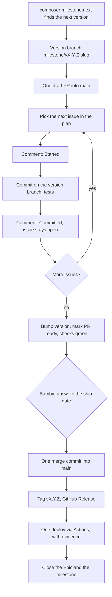

# Contributing to EASM

Thank you for helping. Please write in UK English. Set up Laravel Herd first ([Start here in AGENTS.md](AGENTS.md#start-here)). Words you don't know are in the [glossary](docs/glossary.md). Shipping follows Cursor's `github-milestone-completion` and `ship-gate` skills; version names and packaging detail: [docs/shipping.md](docs/shipping.md).

## The flow

## A worked example: one issue

Say issue #123, "[Bug] The animal filter resets on reload", is in milestone `v1.3.0 Beta: Public UX & compliance`. In Cursor, `/work-on-issue` runs these steps for you.

1. **Start.** Assign the issue if nobody has it: `gh issue edit 123 --add-assignee apescic-director`. Stay on the version branch from `composer milestone:next` (for example `milestone/v1-3-0-public-ux-compliance`). Run `repo-sync`.
2. **Comment before any code** (Started via `github-closeout`): branch, milestone PR, and a short plan.
3. **Work.** Commit `fix: keep the animal filter on reload (Refs #123)` on the milestone branch, push, run `composer test` and `composer lint`, and check <https://easm.test:5176>.
4. **Committed.** Post the Committed comment with SHAs and what was verified. Do **not** close the issue; `Closes #123` on the one milestone PR into `main` closes it on merge.
5. When every leaf is committed, `/finish-version`, `/release-version` and `/deploy-version` handle the merge into `main`, the release and the deploy, each after Bambie's ship-gate answer.

## Code style and checks

- `.editorconfig` sets UTF-8, LF line endings, 4-space indents (2 for YAML) and a final newline. Most editors follow it automatically.
- PHP style is [Laravel Pint](https://laravel.com/docs/pint): `composer lint` checks it, and `composer format` fixes it.
- `composer test` runs PHPUnit. Tests treat the app as already installed (`APP_INSTALLED=true`), apart from the installer tests.
